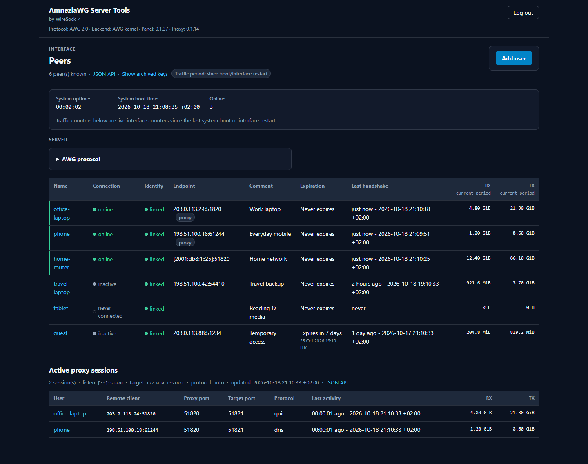
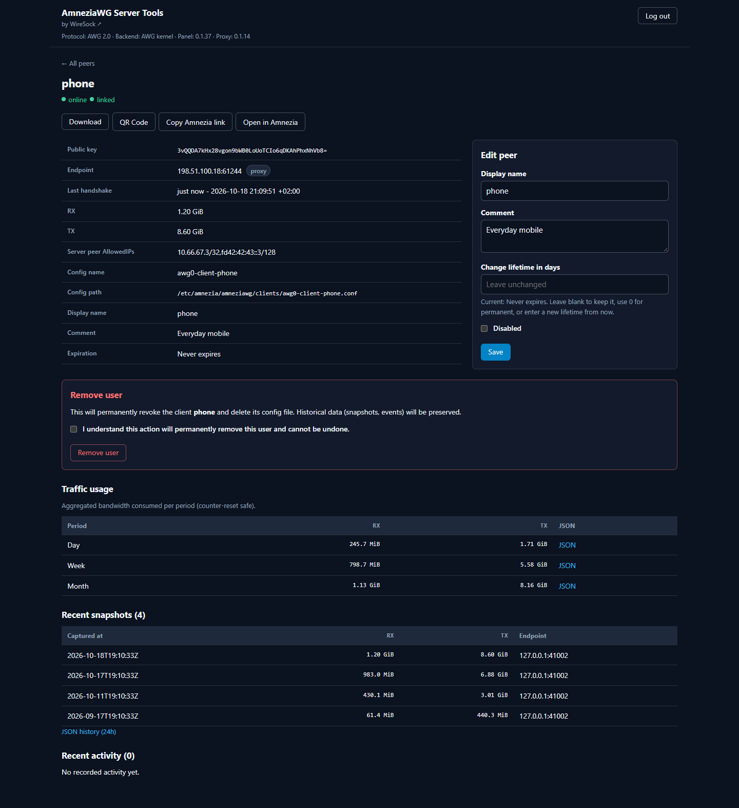

# WireSock AWG Server Tools

**Deploy, manage, and obfuscate AmneziaWG VPN servers on Linux.**

A [WireSock](https://www.wiresock.net/) toolkit for installing and managing
AmneziaWG VPN servers, client configurations, and traffic obfuscation. It
supports the **kernel backend** by default and an experimental **BoringTun
userspace backend**. New installations use **AmneziaWG 2.0**, with an optional,
explicit migration to **AWG 3.1**. An optional web panel handles client
administration, traffic monitoring, configuration exports and optional email
delivery, and BoringTun's built-in imitation or the standalone UDP proxy can
disguise VPN traffic as QUIC, DNS, SIP or STUN.

**Choose backend → Install VPN → (optional) Web panel → Manage clients**

> The repository was renamed from `wiresock/amneziawg-install` to
> `wiresock/awg-server-tools`. Existing installations keep the same commands,
> services, and paths. See [Repository rename](docs/REPOSITORY_RENAME.md).

## Components

| Script | What it does | Docs |
|---|---|---|
| `amneziawg-install.sh` | Installs the AmneziaWG server (kernel or BoringTun backend), manages clients, AWG 2.0 / 3.x protocol mode and BoringTun imitation. | [Installer guide](docs/src/installer/README.md) |
| `amneziawg-web.sh` | Installs, upgrades and removes the Rust web panel (clients, traffic history, exports, protocol switching, email delivery). | [Web panel](amneziawg-web/README.md) |
| `amneziawg-proxy.sh` | Installs the UDP obfuscation proxy that makes traffic look like QUIC, DNS, STUN or SIP to DPI. **Kernel backend, AWG 1.0/2.0 only.** | [Proxy usage](amneziawg-proxy/doc/USAGE.md) |

> **⚠️** `amneziawg-proxy` is **not compatible with AWG 3.0+** (AWG 3.0 uses
> S1–S4 padding as key material for header protection). Its full bidirectional
> imitation requires [WireSock Secure Connect](https://www.wiresock.net/) 3.5+;
> standard AmneziaWG clients still benefit from server-side obfuscation.

## Web panel preview

**Peer overview** — connection status, traffic counters, expiration dates, and
active standalone proxy sessions.



**Peer details** — configuration download and QR actions, editable client
settings, and traffic usage over time.



See the [web panel documentation](amneziawg-web/README.md) for features and setup.

## Supported distributions

The installer's OS check (`checkOS` in `amneziawg-install.sh`) accepts:

| Distribution | Minimum version | Fresh install |
|---|---|---|
| Debian / Raspbian | 11 (Bullseye) | ✅ |
| Ubuntu | 22.04 (CI-tested on 22.04, 24.04, 26.04) | ✅ |
| Linux Mint | 21 | ✅ |
| Fedora | 39 | ❌ temporarily disabled |
| AlmaLinux / Rocky Linux | 9 | ❌ temporarily disabled |
| CentOS | 9 | ⚠️ untested, not recommended |

Fresh installs on Fedora, AlmaLinux and Rocky Linux are **temporarily
disabled** because verified AmneziaWG 2.0 packages are not currently available
for these RPM-based distributions; existing installs there can still run
non-install operations. CentOS 9 is accepted by the installer's OS check and
uses the same AmneziaWG COPR as other RPM-family hosts, but it is **not** a
tested install target and is not recommended (CI does not exercise CentOS).
The BoringTun backend requires a supported Debian/Ubuntu VM or bare-metal host
with systemd, TUN and IPv6 socket support on x86_64, aarch64 or ARMv7
hard-float.


## Quick start

**1. Download the installer:**

```bash
curl -fLO https://raw.githubusercontent.com/wiresock/awg-server-tools/main/amneziawg-install.sh
chmod +x amneziawg-install.sh
```

> **TODO (future):** once signed releases with a `SHA256SUMS` file are
> published, replace the download above with a pinned release URL and
> `sha256sum -c SHA256SUMS --ignore-missing`. This path does **not** exist yet.

**2. Install, choosing one backend (fresh installs only):**

```bash
# Kernel backend (default)
sudo ./amneziawg-install.sh

# BoringTun userspace backend (experimental)
sudo AWG_BACKEND=boringtun AWG_BORINGTUN_IMITATE_PROTOCOL=none ./amneziawg-install.sh
```

Choosing BoringTun does not migrate an existing kernel installation.

**3. (Optional) Add the web panel:**

```bash
curl -fLO https://raw.githubusercontent.com/wiresock/awg-server-tools/main/amneziawg-web.sh
chmod +x amneziawg-web.sh
sudo ./amneziawg-web.sh install
```

The panel is built from Rust source and needs `git` when run standalone
(or use `--binary-src` with a pre-built binary); `--install-rust` installs a
toolchain if needed. See [Panel install](amneziawg-web/docs/INSTALL.md).

**4. (Optional) Add the obfuscation proxy (kernel backend, AWG 1.0/2.0):**

```bash
curl -fLO https://raw.githubusercontent.com/wiresock/awg-server-tools/main/amneziawg-proxy.sh
chmod +x amneziawg-proxy.sh
sudo ./amneziawg-proxy.sh
```

BoringTun users don't need the proxy: enable Off / DNS / QUIC / SIP / STUN
under **Protocol imitation · BoringTun** in the panel, or via the CLI below.

## Basic usage

After installation:

- The client config is saved to `~/awg0-client-<name>.conf`; import it into any
  AmneziaWG client.
- The web panel listens on `127.0.0.1:8080` by default. Change
  `AWG_WEB_LISTEN` or use a reverse proxy for remote access.
- Re-run `sudo ./amneziawg-install.sh` to manage clients interactively.

**Clients (non-interactive):**

```bash
sudo ./amneziawg-install.sh --add-client alice
sudo ./amneziawg-install.sh --remove-client alice
sudo ./amneziawg-install.sh --list-clients
```

**Protocol mode (AWG 2.0 is the default; never changed implicitly):**

```bash
sudo ./amneziawg-install.sh --protocol-status
sudo ./amneziawg-install.sh --enable-awg31   # AWG 3.1 — not with amneziawg-proxy
sudo ./amneziawg-install.sh --disable-awg3   # return every config to AWG 2.0
```

**BoringTun backend:**

```bash
sudo ./amneziawg-install.sh --backend-status
sudo ./amneziawg-install.sh --set-boringtun-imitation <none|dns|quic|sip|stun|auto> [hostname]
sudo ./amneziawg-install.sh --upgrade-boringtun
sudo ./amneziawg-install.sh --rollback-boringtun
```

**Web panel lifecycle:**

```bash
./amneziawg-web.sh status                 # no sudo needed
sudo ./amneziawg-web.sh upgrade
sudo ./amneziawg-web.sh uninstall --force # keeps config and data
sudo ./amneziawg-web.sh uninstall --purge-config --purge-data --force
```

**Proxy:** re-run `sudo ./amneziawg-proxy.sh` for the management menu (status,
logs, reconfigure, uninstall).

## Documentation

| Topic | Link |
|---|---|
| Non-interactive install & all env vars | [docs/src/installer/non-interactive.md](docs/src/installer/non-interactive.md) |
| AWG 3.0 / 3.1 mode | [docs/src/installer/awg3.md](docs/src/installer/awg3.md) |
| Obfuscation parameters | [docs/src/reference/obfuscation-parameters.md](docs/src/reference/obfuscation-parameters.md) |
| BoringTun backend & imitation | [docs/src/boringtun/README.md](docs/src/boringtun/README.md) |
| Web panel | [amneziawg-web/README.md](amneziawg-web/README.md), [deployment](amneziawg-web/docs/DEPLOYMENT.md), [email delivery](amneziawg-web/docs/EMAIL_DELIVERY.md) |
| Proxy | [usage](amneziawg-proxy/doc/USAGE.md), [architecture](amneziawg-proxy/doc/ARCHITECTURE.md), [manual deployment](amneziawg-proxy/doc/MANUAL_DEPLOYMENT.md) |
| Versioning | [docs/VERSIONING.md](docs/VERSIONING.md) |
| Docs site map (mdBook) | [docs/DOCS_STRUCTURE.md](docs/DOCS_STRUCTURE.md) |
| Licensing | [docs/LICENSING.md](docs/LICENSING.md), [NOTICE.md](NOTICE.md) |


## Contributing

See [CONTRIBUTING.md](CONTRIBUTING.md) (and
[amneziawg-web/CONTRIBUTING.md](amneziawg-web/CONTRIBUTING.md) for the panel).
Contributions are accepted under the same license.

## Credits

Derived from [angristan/wireguard-install](https://github.com/angristan/wireguard-install)
through [RomikB/amneziawg-install](https://github.com/RomikB/amneziawg-install)
and [Varckin/amneziawg-install](https://github.com/Varckin/amneziawg-install), whose history this repository continues. See [NOTICE.md](NOTICE.md) for the full lineage.

## License

[MIT](LICENSE). Original authors keep their notices (angristan, Roman
Zakharchuk, Markus Varckin, Vadim Smirnov d/b/a WireSock). Third-party software
(BoringTun — BSD-3-Clause; Rust crates; AmneziaWG kernel module and tools —
GPL-2.0, not distributed here) keeps its own license. Per-file SPDX metadata
follows [REUSE](https://reuse.software) and is checked in CI. See
[docs/LICENSING.md](docs/LICENSING.md).
