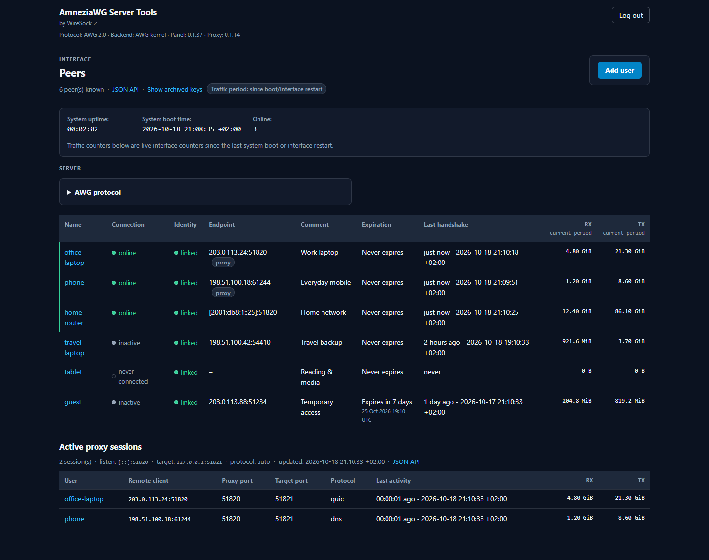
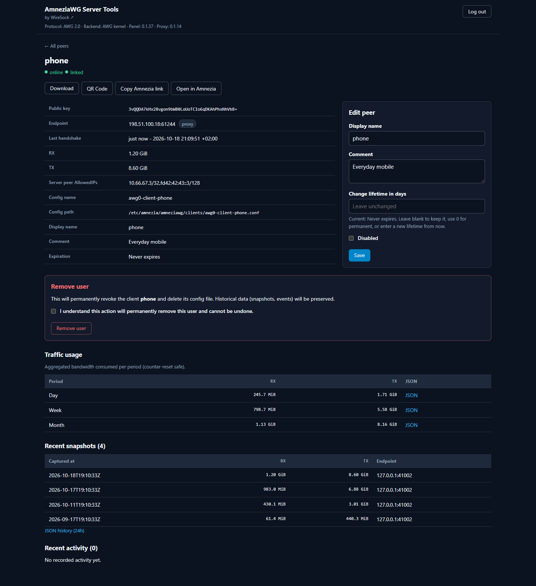

# Introduction

**Deploy, manage, and obfuscate AmneziaWG VPN servers on Linux.**

A [WireSock](https://www.wiresock.net/) toolkit for installing and managing AmneziaWG VPN servers, client configurations, and traffic obfuscation. Supports the **kernel backend** by default and an experimental **BoringTun userspace backend**. New installations use **AmneziaWG 2.0**, with optional support for **AWG 3.1**.

Extend your setup with a **web-based management panel** for client administration, traffic monitoring, and configuration exports. The panel also supports optional [email delivery](web-panel/email-delivery.md) of client configurations or expiring download links, with recipient preview and a separately configured public HTTPS endpoint.

For advanced traffic camouflage, use **BoringTun's built-in protocol imitation** or the standalone **UDP obfuscation proxy** (kernel backend, AWG 1.0/2.0 only) to disguise VPN traffic as QUIC, DNS, SIP, or STUN.

**Choose backend → Install VPN → (optional) Web panel → Manage clients**

——

The repository was renamed from `wiresock/amneziawg-install` to
`wiresock/awg-server-tools`. Existing installations keep the same commands,
services, and paths. See [repository rename and compatibility](project/repository-rename.md)
for updating Git remotes and verifying older releases.

## Web panel preview

**Peer overview** — connection status, traffic counters, expiration dates, and
active standalone proxy sessions.

**Peer details** — configuration download and QR actions, editable client
settings, and traffic usage over time.

See the [web panel documentation](web-panel/README.md) for features and setup.

## How it works

- **`amneziawg-install.sh`** — **required.** Installs the VPN server with the selected backend, generates obfuscation parameters, creates client configs, and can transactionally enable AWG 3.1 after capability checks or return the installation to AWG 2.0. The CLI also retains legacy AWG 3.0 support.
- **`amneziawg-web.sh`** — **optional.** Unified script for:
  - `install` — install the web panel
  - `upgrade` — upgrade the binary
  - `uninstall` — remove the panel
  - `status` — show installation status
- **`amneziawg-proxy.sh`** — **optional.** Installs and manages the UDP obfuscation proxy that fronts AmneziaWG (**AWG 1.0 or 2.0**) and makes the traffic look like QUIC, DNS, STUN, or SIP. See **[Traffic obfuscation proxy](proxy/README.md)**.

---
